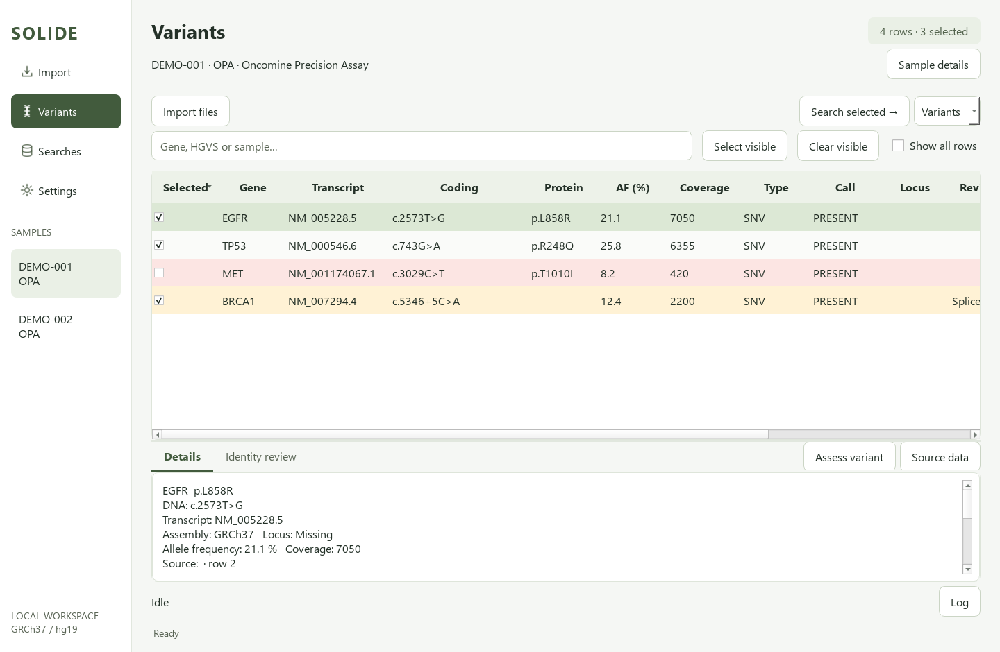

# Solide

Local Windows desktop app for solid tumour variant review. Import Ion Reporter
and Genexus exports, review row-level quality, select variants, collect database
evidence through Edge, and export an Archer/VPM-style Excel workbook for each analysis.



## Install and start

Python 3.11+ and Microsoft Edge are required.

```powershell
python -m pip install -e ".[dev]"
python start_python_felles.py
```

After installation, `SOLIDE_START.cmd` also starts the app.

For the laboratory's **Python FELLES** environment:

1. Keep the complete project in a permanent folder.
2. Double-click **SOLIDE_INSTALL.cmd**. Paste the copied command into Python FELLES
   with Ctrl+V and press Enter.
3. When installation finishes, close Python FELLES.
4. Double-click **SOLIDE_START.cmd** and paste its command to start the app.
5. Open a TSV file. No workspace folder or saved review is needed.

The launchers follow [MolStat](https://github.com/Christian-Bjornstad/MolStat):
Ivanti opens Python FELLES (app ID 15694), and installation/startup run inside
that interpreter. On ordinary Windows PCs the same launchers use local Python.
SOLIDE_INSTALLER.cmd also delegates to the installer. Errors stay visible, with
bootstrap diagnostics in `%LOCALAPPDATA%\Solide\logs\bootstrap.log`.
See [installation instructions](docs/INSTALLATION.md) for interpreter selection
and direct Python commands. Work-PC Ivanti/access must be checked there.

## Workflow

1. **Import** opens one original TSV per sample. The file's columns and assay
   metadata detect Ion Torrent or OPA. An unambiguous OUM opens directly; enter
   one if missing or conflicting. The required field accepts `26OUM12345` and
   converts lowercase to uppercase. Files naming multiple samples are rejected.
   Import details contains assay and genome controls; hg19 is the
   workspace default when the file omits it. Unknown or conflicting inputs need
   confirmation. The file overview lists Sample, Analysis, File and Rows.
2. **Variants** uses the sample list on the left. Files start with no variants
   checked. Tick **Valgt**, or highlight rows and press **Bruk markerte rader**
   to replace this file's checked set. **Fjern valg** clears all choices in this
   file, including rows hidden by a filter. Highlighting cells alone is for
   copying to Excel with Ctrl+C. Multiple transcript annotations become separate
   purple choices, each with its own checkbox. When selected searches start, the
   app confirms the exact transcript's gene with NCBI and checks each candidate
   against the original genomic event in Mutalyzer. This check also runs when the
   Mutalyzer screenshot source is unchecked. Unconfirmed choices remain marked
   for review and cannot be queried or exported as findings. Low-coverage cells retain their red warning.
   Original rows occur once in Excel raw data, with each annotation linked by provenance.
   **Variant details** opens optional
   identity review and assessments. The normal view omits
   unselected absent Genexus calls and CNV/RNA quality rows; **Show all rows**
   restores them. The **Quality** workspace view always checks all imported rows.
3. **Searches** contains **Sources / tissue**, database runs, results, selective
   retries and **Export Excel**. MTBP tissue defaults to Other. Match states and
   source assertions stay distinct from laboratory classifications.
4. **Settings** contains appearance, browser behaviour and database accounts.
   The IGV warning distance for nearby selected variants defaults to 10 bp and
   can be adjusted here; **Save settings** retains it for the next launch.

For OPA sequence variants with a `c.` change and no transcript, the app uses the
45 exact, versioned NM references from the laboratory's **Variantformatering
OPA.xlsx → NM-nummer** list. The source cells remain intact and the supplied
reference is recorded in provenance. Explicit references are preserved. OPA MET
and FGFR1 use this laboratory list without the Ion Torrent MANE substitution.
NM identifies the transcript for a `c.` description; NC identifies the chromosome
and its assembly version for genomic checks. Intronic descriptions can retain
both as `NC_(NM_):c.`. Missing REF/ALT still requires review before a normalized
name can be applied automatically.

Annotation checks handle unequal or reordered lists, duplicate transcripts and
missing names without constructing all gene/name combinations. HGVS brackets and
fusion/CNV events stay intact. Gene/transcript columns can be repaired only when
their cell contents prove they were reversed; original cells and repair provenance
remain available. Exact public NM/NR references are fetched lazily and cached only
in memory during the run. Missing REF/ALT, unresolved versions, multiple ALT
alleles or unavailable reference services require review/retry. Automatic splitting
is bounded to 64 transcript choices and 64 names per source row. The current
database workflows use confirmed GRCh37/hg19 coordinates.

The app icon source is `src/solide/assets/solide.svg`. Edit it and run
`python scripts/build_icon.py` to regenerate the PNG and Windows ICO.

To repeat the synthetic stress run, use
`python scripts/stress_test.py --actions 2500`. It generates OPA/Ion TSVs,
malformed inputs, random GUI interactions and simulated database failures.
It uses no real patients or live accounts. Inputs, reports, screenshots and
results are kept in `artifacts/stress/`; ordinary app use remains temporary.

Each original file is an independent sample analysis; no patient is assumed to
have both OPA and Ion Torrent testing. The same OUM in different files does not
merge their variants, tissue, searches or reports. **Sample details** can correct
an OUM binding without modifying source cells or another analysis. Imported rows, comments, search history and captures stay in the current session.
**Clear files** starts again; closing the app clears its temporary workspace
without a save prompt. Excel edits are not read back. Original source IDs, rows,
metadata and hashes remain available for export.

See [Understanding the supplied raw data](docs/RAW_DATA.md) for the difference
between filtered variant TSVs, full workbooks and reviewed templates.

The workbook follows Archer/VPM: **Oversikt**, a shared **MTBP** report when
available and individual variant sheets with source screenshots. Its source
columns are Solide's eight databases. Complete responses and original rows stay
in hidden **Kilder** and **Rådata** (right-click a tab and choose Unhide).
App-generated workbook text is Norwegian; original classifications, database
prose, screenshots and imported cells retain their source language.
[Report layout and preservation contract](docs/EXCEL_REPORTS.md).
[Norwegian report-cell messages](docs/RAPPORTSVAR.md) distinguish failed access,
unconfirmed identity, missing captures and completed no-hit searches.

**Identity review → Mutalyzer** shows Unchanged, Normalized, Conflict or Review
required. A new name is applied automatically only after an independent check
against the same explicit GRCh37 sequence event and source/MANE transcript.
Conflicts, stale responses and ambiguous gene/transcript choices require review.
**Use checked name** remains available for manual review of other candidates.
If a new confirmed name makes requested results outdated, the same run refreshes
those sources for the selected variant. Explicit single-result reruns keep their
chosen scope; MTBP always retains its selected analysis batch.
Original imported names remain intact. A green normalizer result alone is not
proof that an arbitrary transcript is the right reporting reference.
Protein predictions are displayed and reported without the outer `p.(...)`
parentheses, following the laboratory's reporting convention. Original imported
values and Mutalyzer responses retain their original notation.

SpliceAI runs automatically for selected intronic candidates within ±100 bp.
The search page shows the candidate count. Excel says **Ikke kjørt** when a
selected variant is outside that rule.
Its prediction window is ±500 bp with masked scores on hg19; this window differs
from the rule selecting candidates. The app captures the actual query/settings,
then MANE Select SpliceAI scores, Pangolin scores and Predicted Splicing
Consequences together. The full API transcript data is retained. A failed or
incomplete screenshot retains the API result and appears as **Missing capture**,
available through **Retry failed**, including older SpliceAI-only captures.

Source data, app assessments, reviewed HGVS and search history live only in the current session.
Assessment is performed in the app. Excel is a versioned snapshot; edits to an
exported workbook are not read back.
Pause and stop take effect at checkpoints; active browser or HTTP requests may
need to finish first. Provisional captures remain marked as partial evidence.

### Accounts, activity and reruns

**Settings → Text size** offers 14, 16, 18 and 20 px; 16 px is the default.
Dialogs, dropdowns and progress text keep readable colours with Windows dark themes.

**Settings → Innlogging** supports Franklin, COSMIC, OncoKB and MTBP.
Enter a username and optional password, then **Logg inn / kontroller**. Confirmed
usernames and verified submitted passwords are saved automatically. Usernames stay
in local settings; passwords use Windows Credential Manager under a separate
Solide namespace through [keyring](https://keyring.readthedocs.io/en/latest/).
Passwords are never stored in session JSON, settings JSON, reports or logs.
**Glem passord** removes the stored credential; it does not clear Edge cookies.
Verified logins are green in Settings and source choices; all four confirmed
logins show **Innlogget på alle**. After restart the saved timestamp is a past
check, shown as **Sist bekreftet** until checked again. Failed authentication
removes green status. **Avbryt**, navigating away and closing the login window
cancel the task and release its Edge profile.
If the vault is unavailable, visible sign-in and existing Edge sessions still work.

The **Log** button is available on every page. The activity log and search captures are temporary and cleared on normal close.
Appearance, selected databases and account settings are remembered; browser
sign-in profiles remain available. Existing saved reviews and reports are not deleted.
Running searches show completed source jobs, matches, failures, review needs,
elapsed time and current provider activity. Partial captures do not count as
completed jobs.

- **Run pending**: new, incomplete and outdated source searches.
- **Retry failed**: failed searches, including missing captures and ambiguous results.
- **Rerun… → Selected results**: highlighted result rows, including completed results.
- **Rerun… → All selected variants**: every selected variant and checked source.

Rerunning any MTBP result targets the complete selected batch in that analysis. An uncertain
submission retains its exact report ID and is reconciled before submitting it again.
Previous evidence remains in memory for the current session before replacement.
The result list includes **Pending**, **Verified match**, **Review match**,
**No match**, **Outdated** and explicit failure states. **Verified match** requires
returned genomic identity evidence, or exact versioned HGVS for BRCA Exchange;
a found record alone does not qualify.
Source screenshots are checked for readable content. **View evidence** opens
the source response and captured images. Excel reports include the same match
assessment. Clinical significance still requires professional review.

## Quality and nomenclature

| Check | Result |
|---|---|
| Coverage <500 on a row | Failed coverage |
| CNV Copy Number <1 | Failed CNV |
| CNV Copy Number =1 | Review boundary value |
| RNAExonTiles NO CALL | Failed expression imbalance |
| RNAExonVariant ABSENT | Included as a status, not a positive finding |
| Intronic HGVS offset 1–100 bp | SpliceAI candidate |

Missing numeric QC values are unknown. Coverage describes exported rows, not
whole-gene coverage. Assay / gene-package selection currently follows the imported
export; the laboratory must define any additional panel rules.

Delins / complex variants require Mutalyzer review. Known FGFR1 and MET transcript
differences require mapped, reviewed HGVS on the target transcript:

| Gene | Exported transcript | Target transcript |
|---|---|---|
| FGFR1 | NM_001174067.1 | NM_023110.3 |
| MET | NM_001127500.3 | NM_000245.4 |

The original requirements had the exported accessions exchanged between these
genes. Their gene assignments were checked against the NCBI records for
[FGFR1](https://www.ncbi.nlm.nih.gov/nuccore/NM_001174067.1) and
[MET](https://www.ncbi.nlm.nih.gov/nuccore/NM_001127500.3). Original import values
are preserved; a mapper's suggestion still needs identity review.

Mutalyzer returns suggestions for manual approval in **Identity review**.
When no transcript is available, explicit confirmed GRCh37 REF/ALT can provide
a genomic normalization query. A failed optional MANE mapping retains the
normalization and records its limitation.
For intronic HGVS on an mRNA reference, Mutalyzer may report EINTRONIC because
the reference lacks intronic sequence. If its returned GRCh37 chromosome context
agrees with the source's explicit alleles, the app records a separate genomic
candidate. The original error and descriptions remain available for review.
Corrected HGVS never silently reuses original genomic alleles. Enter matching
reviewed hg19 `chr-pos-REF-ALT` when a genomic lookup is needed after correction.

## Database evidence

ClinVar, Franklin, COSMIC, OncoKB and MTBP use the pinned
[Archer Edge/CDP runtime](docs/ARCHER_REUSE.md). Sign-in uses visible Edge;
automated windows are minimised by default. Edge remote debugging must be allowed.
Mutalyzer, SpliceAI and BRCA Exchange use HTTP adapters. BRCA Exchange runs only
for **BRCA1 / BRCA2**. It checks exact GRCh37 alleles or complete versioned HGVS,
and saves the source classification, accession, dataset release and identity
assessment separately from the app classification. The public API may change:
unexpected or incomplete responses remain explicit review/error states.
[BRCA Exchange API documentation](https://brcaexchange.org/about/api).

SpliceAI requires confirmed GRCh37 and
explicit REF/ALT, uses `distance=500`, `mask=1`, and runs at least 30 seconds apart.
Genexus XLSX may omit REF/ALT; these must be reviewed before genomic searches.

Gene / protein or identifier-only lookups are explicitly labelled. Multiple
genes / transcripts require identity review. Record HSMD results manually in
the variant comment.

Changing variant identity or tissue marks older evidence as outdated. Changing
the selected patient batch also invalidates the MTBP full report. A resumed MTBP
search reruns the whole selected batch when needed. When identity, tissue or
selection changes, old evidence is retained in current-session history and a new batch is
created; stale report content is never reused. The MTBP account is emptied before each new submission. Every new report is
removed after local audit/capture, with delayed server verification. Cleanup
failures block submission and remain retryable. This includes reports created
outside Solide, as requested by the account owner. Errors and partial captures remain distinct from **Not found**.

Patient IDs, local filenames, comments and raw worksheets are not sent to providers.
Adapters receive variant data and pseudonymous search IDs. Authenticated profiles
stay under `%USERPROFILE%\.solide\browser_profiles`. Source files, reports, credentials and browser profiles are excluded from Git.

App timestamps, Excel date cells and report filenames use **Europe/Oslo**, with
automatic summer/winter time. Original API timestamps remain unchanged in source
evidence; displayed capture times are converted to Oslo time.

Live ClinVar, Franklin, COSMIC, OncoKB and authenticated MTBP searches were tested
locally with supplied variant data, including captures, retries, tissue **Other**,
full-report capture and verified MTBP deletion. Institutional access and the
work-PC environment still require a laboratory pilot.

## Excel reports

Press **Export Excel**, choose a destination folder, and the app creates one
timestamped .xlsx workbook for the active OPA or Ion Torrent analysis.
No report is generated automatically. Previous exports and original inputs are preserved.
Screenshots are embedded in the workbook and remain readable after the app closes.

- **Overview**: variant identity and concise source findings. MTBP shows its
  functional relevance/evidence text, Franklin and ClinVar their classifications,
  OncoKB its oncogenicity, and COSMIC a linked mutation ID. The upper note box
  and Comment cells start blank for manual notes in Excel. Gene names are plain text.
- **MTBP**: the shared combined report, when current capture evidence is available.
- **Variant sheets**: an identity header and source screenshots in database order.
  No lengthy assessment/source-detail appendices or internal worksheet links.
- Hidden **Sources** and **Raw data**: complete API responses, provenance and
  original values retained as literal ranges without Excel structured tables.

The exported attachment has no Quality worksheet. Review all-row quality and
laboratory assessments in the app. Matching states and retry diagnostics remain
in the app; unavailable or outdated evidence cannot appear as a positive result.
Full-height source images remain intact, with valid MTBP display cropping only.
Excel edits are not read back into the app.

The everyday import dialog accepts original Ion Reporter and Genexus TSV files.
The underlying parser also supports Genexus XLSX exports with one
unambiguous variant table. The supplied Childhood/Oncomine Ion export and
Genexus/OPA exports were both verified. Ion metadata that indicates a filtered
export produces an import warning and report scope note; QC covers supplied
rows rather than variants omitted by upstream filters. Reviewed child templates, target/gene coverage tables
and sample-level QC sheets are separate source structures and are not imported
as variants. ZIP archives were inspected as design references; extract an original
TSV/XLSX export locally before importing. Duplicate columns or competing variant
tables are rejected rather than silently overwriting or duplicating records.
Workbooks exported by Solide are report snapshots and are not import sources.
An empty Call cell falls back to a populated Genotype without altering either
source column. Explicit calls take precedence. Ion genotype strings do not
automatically select rows for search; use the Workspace checkboxes.

Text is written safely as text, including original values starting with formula
characters. Excel's cell limit still applies; the current session retains full source
values and responses until close. Export Excel before closing to keep a report.

## Development

```powershell
python -m pytest -q
python -m compileall -q src install_python_felles.py start_python_felles.py
python scripts/render_preview.py
```

Tests use synthetic fixtures. The optional local reference-file test is skipped
when the laboratory's untracked input files are absent. The UI preview is synthetic.
Additional private checks used the supplied raw files, archive workbooks and actual
Excel exports; their data, sessions, reports and screenshots stay outside Git.
See [verification](docs/VERIFICATION.md) for tested scope and remaining checks.
